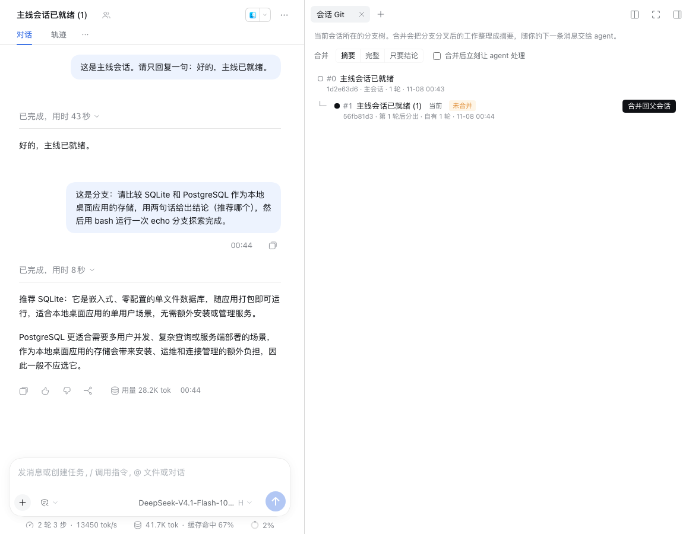
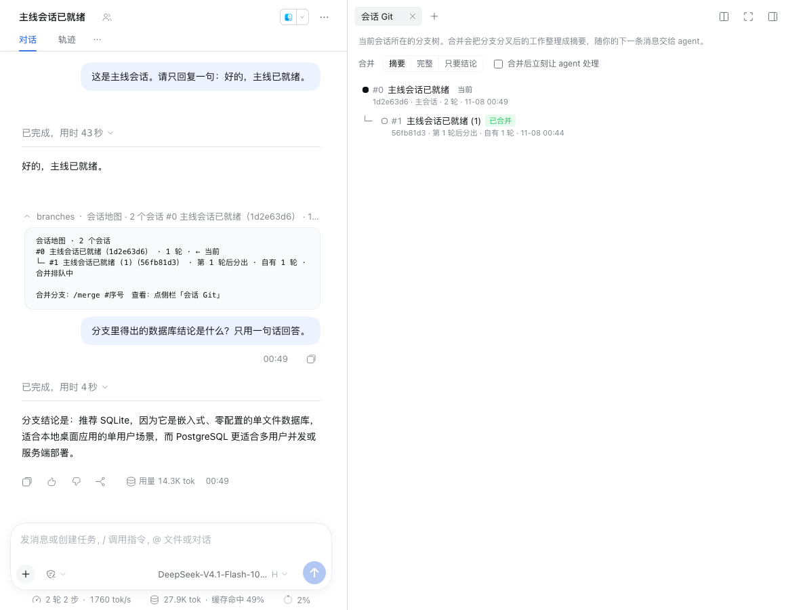
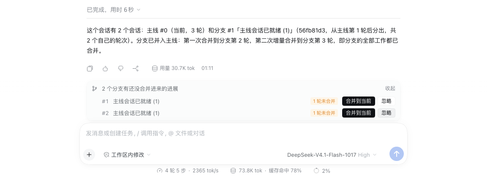
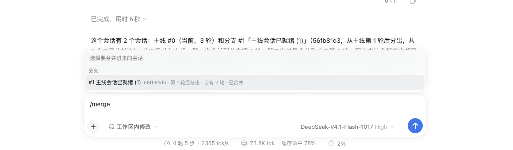

# Session Git

English | [中文](README.zh.md)

A DeepSeek Harness plugin that draws your forked sessions as a branch tree and merges a branch's finished work back into the main session as a digest, so you don't have to retype what the branch found.

Forking a session to explore is easy in Harness, but the main session can't see what happened in the fork: its conclusions, the files it changed, the commands it ran, the decisions you made there. Session Git brings that back.

## Features

- **Branch map**: the "Session Git" tab in the right sidebar shows the tree around the current session: where each branch forked, how many turns it has of its own, and how far it has been merged. The "Session Git" panel in the left sidebar lists every forked tree in the workspace.
- **One-click merge**: in the main session, click "Merge here" on a branch; inside a branch, click "Merge into parent". Or type `/merge`.
- **Incremental merges**: merging the same branch again brings only what is new since the last merge. Add `--all` to start over from the fork point.
- **Silent by default**: the digest is queued and reaches the agent with your next message, without interrupting the conversation. A strip above the composer says the merge is queued. Add `--wake`, or write a note after `--`, to have the agent act right away.
- **Unmerged reminders**: when you come back to the main session and a branch has new work that isn't merged yet, the strip above the composer offers "Merge here" or "Ignore". It comes back once the branch completes another turn.
- **The agent can use it too**: the runtime context tells the agent which branches exist. When you say "bring in what the branch found", it can call `session_branches` and then `session_branch_merge`. What the agent reads this way counts as a merge too.

## Screenshots

The screenshots show the Chinese UI; the plugin's panels follow the Harness language, and command results follow the language of the conversation.

Inside a branch, the "Session Git" tab in the right sidebar merges it into its parent in one click:



Back in the main session, the agent already has the branch's conclusion, and the map marks the branch as merged:



When branches have new work that isn't merged yet, a strip above the composer says so:



Typing `/merge` on its own opens a branch picker:



## Install

Requires DeepSeek Harness 0.2.1-rc.5 or later.

In DeepSeek Harness, open Plugins → Add plugin → Install a third-party plugin, and enter the GitHub repository address:

```
https://github.com/glk1220/dsh-session-git
```

Installing from GitHub needs this machine to reach GitHub. You can also download the repository and enter the absolute path of the plugin folder in the same dialog.

From the command line:

```bash
dsh plugin --profile web add github:glk1220/dsh-session-git
```

Restart Harness when it asks you to.

## Usage

### In the UI

1. Click "Branch into a new conversation" under a reply, or choose "Fork session" from the session's menu in the sidebar, and explore in the fork.
2. When you're done, open "Session Git" in the fork's right sidebar and click "Merge into parent". Or go back to the main session and click "Merge here" in the strip above the composer.
3. Send your next message in the main session as usual. The agent answers with the branch's digest in view.

Sidebar options:

- "Summary", "Full" and "Conclusion only" set how detailed the digest is.
- "Let the agent act right away" is the same as `--wake`.

### Commands

```
/merge [#number|title|id] [summary|full|last|Nturns] [--all] [--wake] [--up] [-- note]
/branches
```

| Form | Meaning |
| --- | --- |
| `/merge` | With one branch, merges it. With several, merges the only one with new work, or lists them for you to pick. Inside a branch that has no branches of its own, merges it into its parent. Typing `/merge` alone in the composer opens a branch picker. |
| `/merge #2` | Picks a branch by its number on the map. A title (partial match) or the first 4+ characters of a session id also work. |
| `summary` / `full` / `last` | How detailed the digest is; `summary` is the default. |
| `turns:3` | Only the most recent 3 turns, in full detail. |
| `--all` | Ignore earlier merges and start over from the fork point. |
| `--wake` | Wake the agent right after merging. |
| `--up` | Merge the current branch into its parent. |
| `-- note` | Everything after `--` is sent to the agent as your message, with the digest delivered alongside, so the agent starts at once. |
| `/branches` | Prints the branch map in the conversation. |

### What a digest contains

A digest is background material for the agent. Its sections, with step detail compressed first when it runs over the size limit:

1. How the branch relates to this session: where it forked and which turns this merge covers.
2. The branch's goal, if one was set.
3. Each turn: your message, the gist of the agent's reply, the tools it used, and work delegated to subagents.
4. Decisions you made in the branch, such as answers to the agent's questions.
5. Files changed and commands run.
6. The to-do list and compaction summaries.
7. The branch's final conclusion.

The digest opens by telling the agent that plans and to-dos from the branch are only a record and need your go-ahead, and that when both sessions share a working directory, the branch's file changes are already on disk and the actual files win.

## Configuration

Override the whole `config` of the entry with id `session-git` in your profile's `cordis.patch.yml`:

| Option | Default | Meaning |
| --- | --- | --- |
| `runtimeContext` | `true` | Tell the agent in its runtime context which branches this conversation has. Only rarely changing facts (the branch list and fork points) go there, so the context snapshot is not re-sent often. |
| `tools` | `true` | Give the agent the `session_branches` and `session_branch_merge` tools. |
| `maxDigestChars` | `24000` | Character budget for one digest, 2000–200000. |
| `maxContextBranches` | `8` | How many branches the runtime context lists at most. |
| `locale` | `auto` | Language of command results and digests: `auto` follows the conversation; `zh` or `en` forces one. |

## Known limitations

- A queued merge behaves like a queued message: if you press Stop, or restart Harness, before the agent reads it, Harness cancels it. The strip above the composer then shows the branch as not merged again; merge once more and nothing is lost.
- Silent merges don't appear in the conversation itself, because Harness doesn't render plain context injections. Their state shows in the strip above the composer and on the branch map.
- Subagent sessions are left off the map; branches under them hang off the nearest visible session.
- Merging reads the session records on this machine. The plugin makes no network requests and sends your sessions nowhere.

## Development

```bash
npm test
```

```bash
npm run check
```

`npm test` runs the unit tests. `npm run check` is the pre-publish check: file list, exports, syntax, dependencies, style tokens, locale metadata and icon. The plugin depends on no npm packages: the Host half uses only Node built-ins, and Harness's module loader provides React to the client half.

## License

[MIT](LICENSE)
