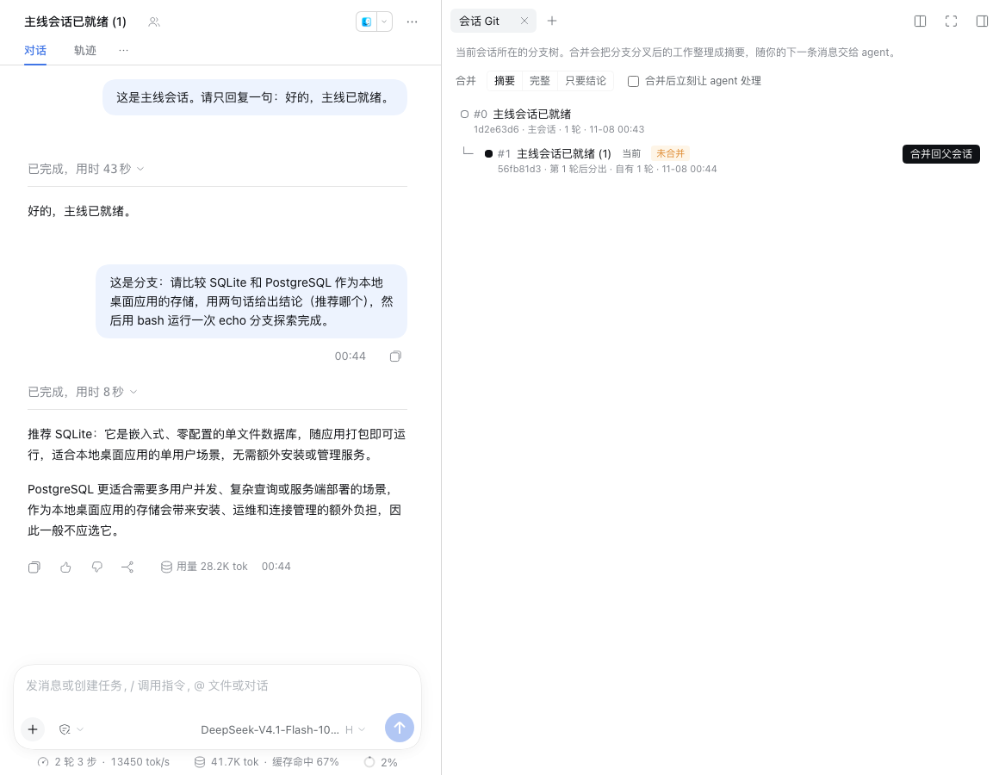
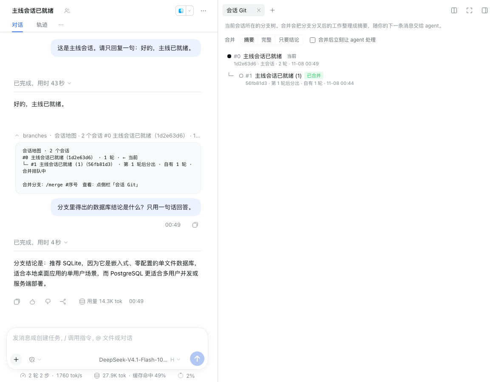
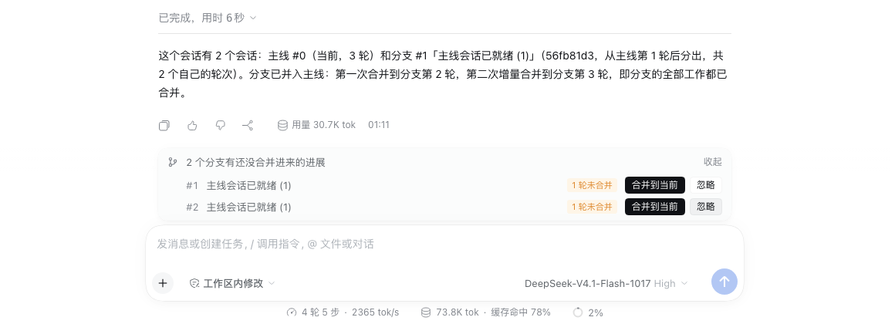
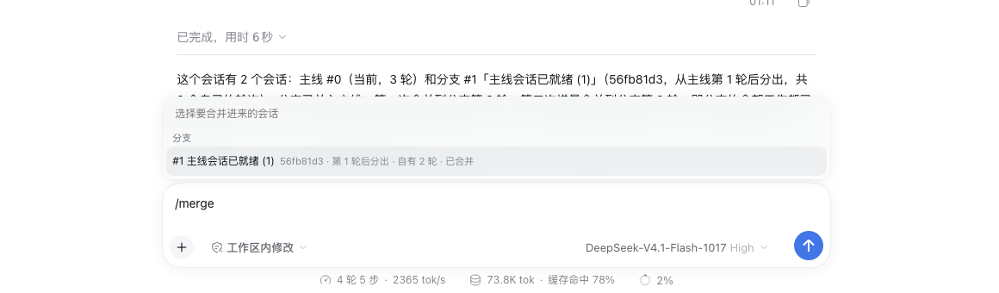

# 会话 Git

[English](README.md) | 中文

DeepSeek Harness 插件：把 fork 出去的会话画成一棵分支树，并把分支里做完的事整理成摘要，一键合并回主会话，不用再把结论重新敲一遍。

在 Harness 里 fork 一个会话去探索很方便，但主会话看不到分支里发生了什么：分支得出的结论、改过的文件、跑过的命令、你在分支里拍板的决定，回到主会话都得重新交代一遍。会话 Git 解决的就是这件事。

## 功能

- **分支地图**：右侧边栏的「会话 Git」标签页显示当前会话所在的分支树，包括每个分支从第几轮分出、自己做了几轮、合并到了哪一轮。左侧栏的「会话 Git」面板列出工作区里所有分叉过的会话树。
- **一键合并**：在主会话里，对分支点「合并到当前」；在分支里，点「合并回父会话」。也可以直接输入 `/merge`。
- **增量合并**：同一个分支第二次合并时只带上次之后的新内容。想从分叉点重新整理，加 `--all`。
- **默认静默并入**：摘要先排进收件箱，随你的下一条消息一起交给 agent，不打断当前对话。输入框上方会显示「已排队合并…」。想让 agent 马上处理，加 `--wake`，或者在 `--` 后面写一句附言。
- **未合并提醒**：回到主会话时，如果某个分支有新的进展还没合并进来，输入框上方会提示，可以点「合并到当前」或「忽略」。分支之后再有新的一轮，提示会重新出现。
- **agent 也能用**：运行时上下文会告诉 agent 这段对话有哪些分支。你说「把分支里的结论拿过来」时，agent 可以调用 `session_branches` 查看分支，再调用 `session_branch_merge` 读取摘要。agent 读进来的内容同样记作一次合并。

## 截图

在分支里打开右侧边栏的「会话 Git」，一键合并回父会话：



回到主会话直接提问，agent 已经拿到了分支的结论，地图上这个分支显示「已合并」：



有分支做了新工作还没合并时，输入框上方会提示：



在输入框里单独输入 `/merge` 会弹出分支选择：



## 安装

需要 DeepSeek Harness 0.2.1-rc.5 或更新的版本。

在 DeepSeek Harness 里打开「插件 → 添加插件 → 安装第三方插件」，填 GitHub 仓库地址：

```
https://github.com/glk1220/dsh-session-git
```

从 GitHub 安装需要这台电脑能访问 GitHub。也可以把仓库下载到本机，在同一个对话框里填插件文件夹的绝对路径。

命令行用户也可以这样安装：

```bash
dsh plugin --profile web add github:glk1220/dsh-session-git
```

安装后按提示重启 Harness。

## 用法

### 在界面里

1. 在某条回复下点「在新对话中分支」，或者在侧边栏的会话菜单里选「分叉会话」，开一个分支去探索。
2. 探索完，在分支里打开右侧边栏的「会话 Git」，点「合并回父会话」。也可以回到主会话，点输入框上方提示条里的「合并到当前」。
3. 在主会话里正常发下一条消息，agent 就会带着分支的摘要回答。

右侧边栏的选项：

- 「摘要」「完整」「只要结论」：决定摘要的详细程度。
- 「合并后立刻让 agent 处理」：等同于 `--wake`。

### 命令

```
/merge [#序号|标题|id] [摘要|完整|结论|N轮] [--all] [--wake] [--up] [-- 附言]
/branches
```

| 写法 | 含义 |
| --- | --- |
| `/merge` | 只有一个分支时直接合并它；有多个分支时，合并唯一有新内容的那个，否则列出分支让你选。在一个自己没有子分支的分支里不带参数，表示合并回父会话。在输入框里单独输入 `/merge` 会弹出分支选择框。 |
| `/merge #2` | 按地图里的序号选分支。也可以写标题（支持部分匹配）或会话 id 的前 4 位以上。 |
| `摘要` / `完整` / `结论` | 摘要的详细程度，默认是「摘要」。英文写法是 `summary` / `full` / `last`。 |
| `3轮` | 只要最近 3 轮，按完整细节整理。也可以写 `turns:3`。 |
| `--all` | 忽略之前的合并，从分叉点重新整理。 |
| `--wake` | 合并后立刻唤醒 agent。 |
| `--up` | 把当前分支合并回父会话。 |
| `-- 附言` | `--` 后面的内容作为你的一条消息发给 agent，摘要随它一起交付，agent 会立刻开始处理。 |
| `/branches` | 在对话里打印分支地图。 |

### 摘要里有什么

摘要是给 agent 看的背景资料，按下面几节组织，超出字数上限时会先压缩过程细节：

1. 分支关系：从第几轮分出，本次包含哪几轮。
2. 分支里的目标（如果设置过）。
3. 每一轮的过程：你的消息、agent 的回复要点、用过的工具、子 agent 的委派。
4. 你在分支里做的决定，比如回答过的选择题。
5. 改动的文件和执行过的命令。
6. 待办清单、压缩摘要。
7. 分支的最终结论。

摘要开头会提醒 agent：分支里的计划和待办只是记录，需要你确认才执行；如果两边共用工作目录，分支改过的文件已经在磁盘上，以实际文件为准。

## 配置

在 profile 的 `cordis.patch.yml` 里按 id `session-git` 覆盖整段 `config`：

| 选项 | 默认值 | 说明 |
| --- | --- | --- |
| `runtimeContext` | `true` | 在运行时上下文里告诉 agent 这段对话有哪些分支。只放分支列表和分叉点这类很少变化的信息，避免频繁追加上下文快照。 |
| `tools` | `true` | 给 agent 提供 `session_branches` 和 `session_branch_merge` 两个工具。 |
| `maxDigestChars` | `24000` | 单次合并摘要的字符上限，可设 2000–200000。 |
| `maxContextBranches` | `8` | 运行时上下文里最多列出几个分支。 |
| `locale` | `auto` | 命令结果和摘要的语言：`auto` 按会话内容判断，也可以设 `zh` 或 `en`。 |

## 已知限制

- 排队中的合并和排队消息一样：如果你在 agent 读到它之前点了「停止」，或者重启了 Harness，Harness 会把它取消。这时输入框上方会重新提示「有 N 轮还没合并进来」，再点一次合并即可，不会丢内容。
- 静默合并的消息不会显示在对话流里（Harness 不展示普通的上下文注入），可以在输入框上方的提示条和分支地图上看到状态。
- 子 agent 会话不出现在地图里，它们下面的分支会挂到最近的可见会话上。
- 合并读取的是本机的会话记录，插件不联网，也不会把会话内容发到别处。

## 开发

```bash
npm test
```

```bash
npm run check
```

`npm test` 运行单元测试；`npm run check` 是发布前自检，检查文件清单、导出、语法、依赖、样式令牌、多语言元数据和图标。插件不依赖任何 npm 包：Host 半边只用 Node 内置模块，Client 半边由 Harness 的模块加载器提供 React。

## 许可

[MIT](LICENSE)
